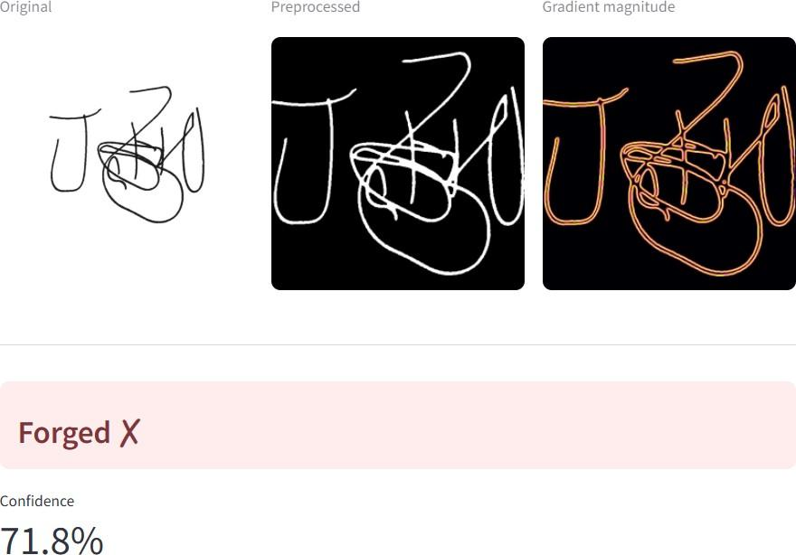
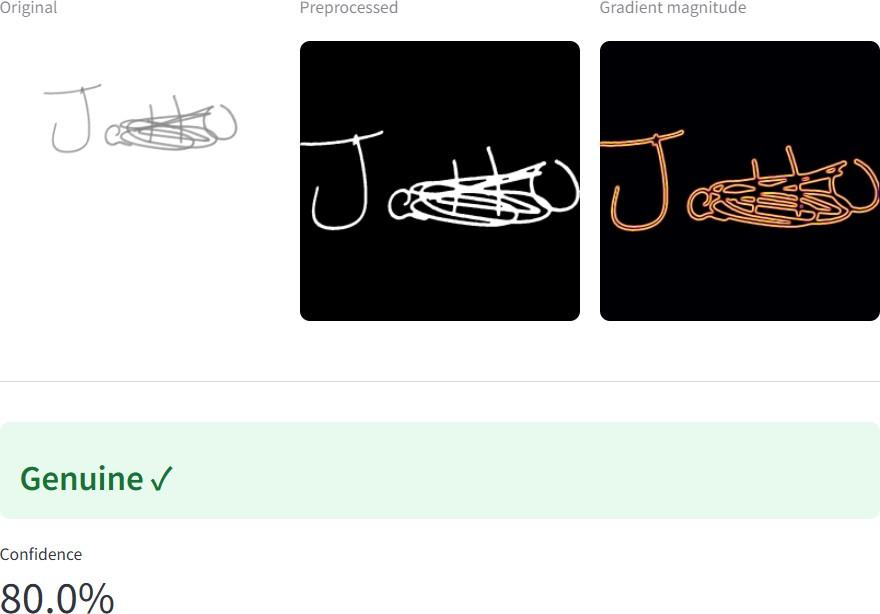
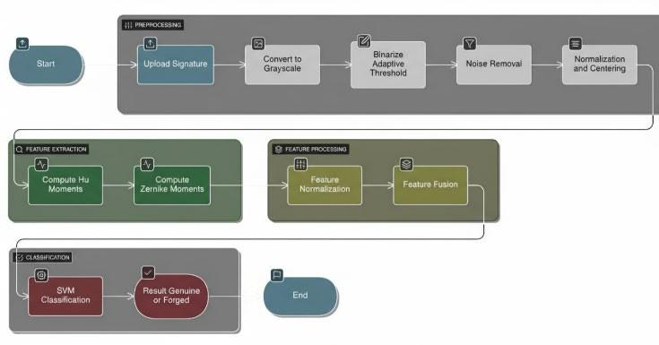
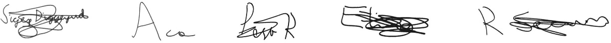
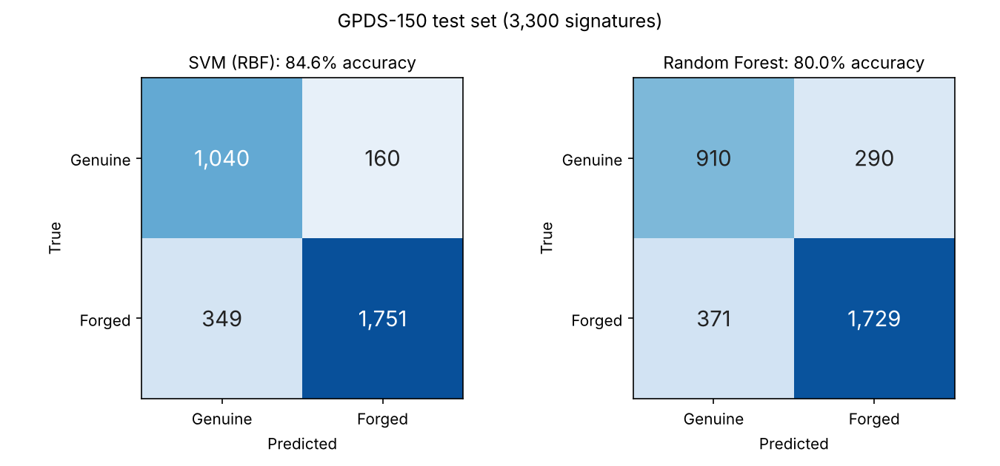

# Robust Offline Signature Verification Using Hu and Zernike Moments

An offline handwritten signature verification system that classifies a scanned signature as **Genuine** or **Forged**. It fuses shape, texture and structural features, centred on Hu and Zernike moments, and classifies them with a tuned **RBF-kernel SVM**. A Random Forest is trained as a baseline. A **Streamlit** app gives instant verdicts with confidence scores.

**Results on GPDS-150 (3,300 held-out test signatures):**

| Model | Accuracy | F1 (forged) | F1 (genuine) | FAR | FRR |
|---|---|---|---|---|---|
| **SVM (RBF)** | **84.6%** | **0.87** | **0.80** | **16.6%** | **13.3%** |
| Random Forest (baseline) | 80.0% | 0.84 | 0.73 | 17.7% | 24.2% |

<p align="center">
  
  &nbsp;
  
</p>

---

## Features

- Offline (image-based) signature verification
- Robust preprocessing: Otsu binarization, morphological closing, cropping and aspect-preserving centring
- **Fused 575-dimensional feature vector**: Hu moments, Zernike moments, LBP texture, grid-directional (HOG-lite) and skeleton structure
- **SVM (RBF)** pipeline with StandardScaler → PCA (95% variance) → 5-fold grid search over C and γ
- **Random Forest** baseline with feature-importance ranking
- Biometric metrics (FAR, FRR) plus a confidence "uncertain band" (0.40–0.60) that flags signatures for manual review
- Feature config saved inside the model, so training and inference always match
- Streamlit app showing the original, preprocessed and gradient-magnitude views alongside the verdict

## System Workflow



## Methodology

### 1. Preprocessing

- Median blur for denoising
- Otsu thresholding, inverted to white strokes on black
- Morphological closing, with a kernel that scales with image resolution
- Crop to the signature's bounding box, resize preserving aspect ratio, and centre on a 256×256 canvas

### 2. Feature Extraction

| Feature | Dims | What it captures |
|---|---|---|
| **Hu moments** | 7 | Global shape; invariant to translation, scale and rotation |
| **Zernike moments** (degree 8) | 25 | Fine shape detail; rotation-invariant |
| **LBP histogram** (R=3, P=24) | 26 | Local stroke texture |
| **HOG-lite** (8×8 grid × 8 bins) | 512 | Spatial layout of stroke directions |
| **Skeleton features** | 5 | Stroke length, endpoints, branch points, branch/endpoint ratio, coverage |
| **Total** | **575** | |

### 3. Feature Fusion

All features are concatenated, standardized, and reduced with PCA to keep 95% of the variance (575 → 409 dimensions).

### 4. Classification

- **Main model:** SVM with RBF kernel. A 5-fold stratified grid search over C ∈ {0.1, 1, 10, 100} and γ ∈ {scale, 0.1, 0.01, 0.001} optimizes F1. **Best: C = 10, γ = 0.001.**
- **Baseline:** Random Forest (300 trees, balanced class weights, min_samples_leaf = 2).

## Dataset

The dataset is **not included in this repository** because of licensing and distribution restrictions.

The models were trained on the **GPDS Signature Database (GPDS 1-150)**, which has genuine signatures and skilled forgeries from 150 writers. Download it [from Kaggle](https://www.kaggle.com/datasets/adeelajmal/gpds-1150?select=New+folder+%2810%29).



| Split | Genuine | Forged | Total |
|---|---|---|---|
| Train (samples 1–16 per writer) | 2,400 | 2,400 | 4,800 |
| Test (samples 17–24 per writer) | 1,200 | 2,100 | 3,300 |

Both splits contain all 150 writers, with no overlapping images. This is a **writer-dependent** evaluation: the model has seen other signatures from each person during training.

The loader searches subfolders recursively for directories named `genuine` and `forge`, so the Kaggle layout works as it is:

```text
dataset/
├── train/
│   ├── genuine/
│   └── forge/
└── test/
    ├── 1/
    │   ├── genuine/
    │   └── forge/
    ├── 2/
    │   ...
```

## Results

### Test set (3,300 signatures)

| | SVM (RBF) | Random Forest |
|---|---|---|
| Accuracy | **84.6%** | 80.0% |
| Precision (genuine) | 0.75 | 0.71 |
| Recall (genuine) | 0.87 | 0.76 |
| F1 (genuine) | 0.80 | 0.73 |
| Precision (forged) | 0.92 | 0.86 |
| Recall (forged) | 0.83 | 0.82 |
| F1 (forged) | 0.87 | 0.84 |
| **FAR** (forgeries accepted) | **16.6%** | 17.7% |
| **FRR** (genuine rejected) | **13.3%** | 24.2% |



The SVM's biggest gain over the Random Forest is on genuine signatures: it **cuts false rejections by almost half** (FRR 24.2% → 13.3%) while also accepting fewer forgeries.

### Confidence-based review band

Predictions with confidence between 0.40 and 0.60 are flagged **"Uncertain: manual review recommended"** instead of getting a hard verdict.

| | SVM (RBF) | Random Forest |
|---|---|---|
| Flagged for review | 10.0% | 28.2% |
| Accuracy on the remaining signatures | **88.4%** | 87.1% |
| FAR / FRR on the remaining signatures | 11.9% / 11.3% | 11.4% / 15.7% |

Sending the least certain 10% of signatures to a human raises SVM accuracy from 84.6% to 88.4%.

## Technology Stack

**Language:** Python

**Libraries:** OpenCV · NumPy · scikit-learn · scikit-image · Mahotas · Streamlit · Pillow · Matplotlib · Joblib · tqdm

## Installation

```bash
git clone https://github.com/bsaaketh/Signature-Verification-Using-A-Fusion-Of-Hu-And-Zernike-Moments.git
cd Signature-Verification-Using-A-Fusion-Of-Hu-And-Zernike-Moments
pip install -r requirements.txt
```

### Train the model

Set `DATASET_ROOT` at the top of `model.py` to your dataset folder, then run:

```bash
python model.py
```

This saves `svm_signature_pipeline.joblib` (main model) and `rf_signature_pipeline.joblib` (baseline), and prints the full metrics for both.

### Run the app

```bash
streamlit run app.py
```

The app loads `svm_signature_pipeline.joblib` by default. You can switch models from the sidebar.

## Project Structure

```text
signature-verification/
├── dataset/            # not included, see Dataset
│   ├── train/
│   └── test/
├── app.py              # Streamlit interface
├── model.py            # feature extraction, training, evaluation
├── requirements.txt
├── assets/             # README images
└── README.md
```

## Future Work

- Writer-independent evaluation, testing on writers never seen in training
- CNN or Siamese network to learn features directly from signature images
- Tune the decision threshold to trade FAR against FRR for banking use
